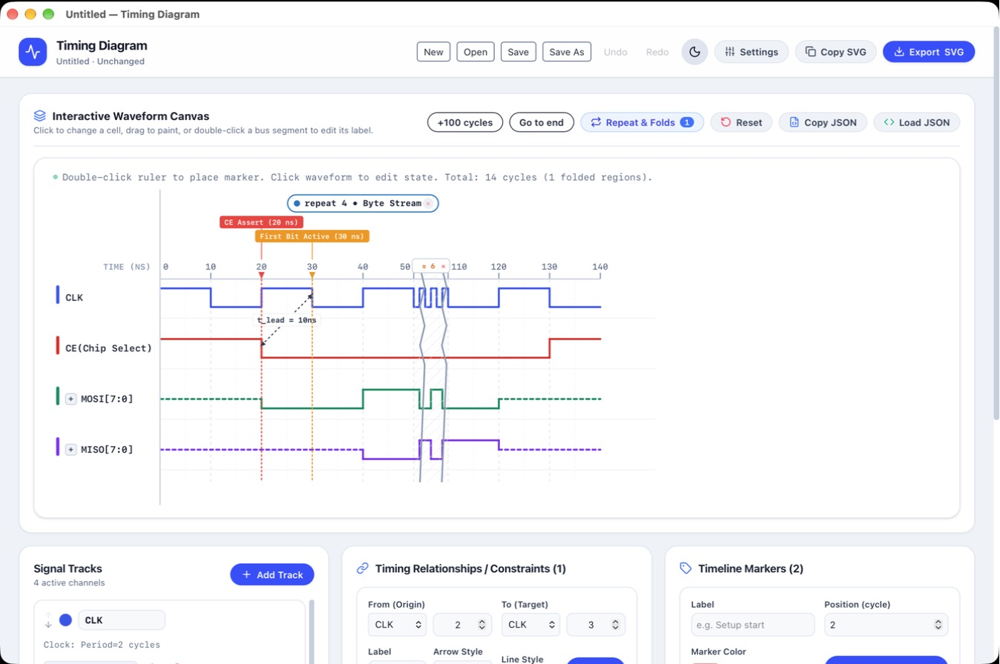
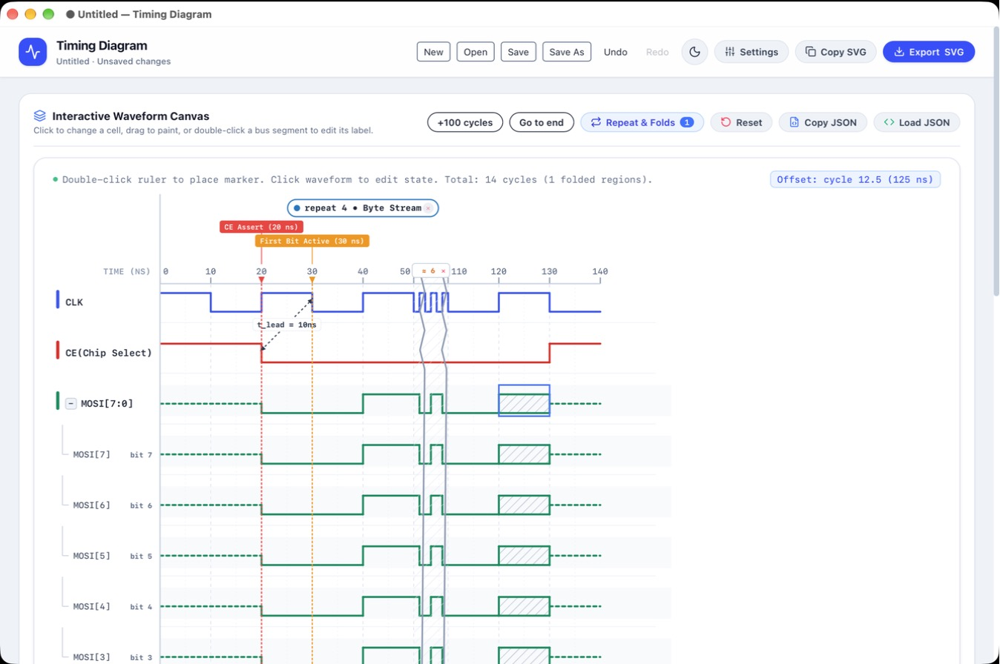
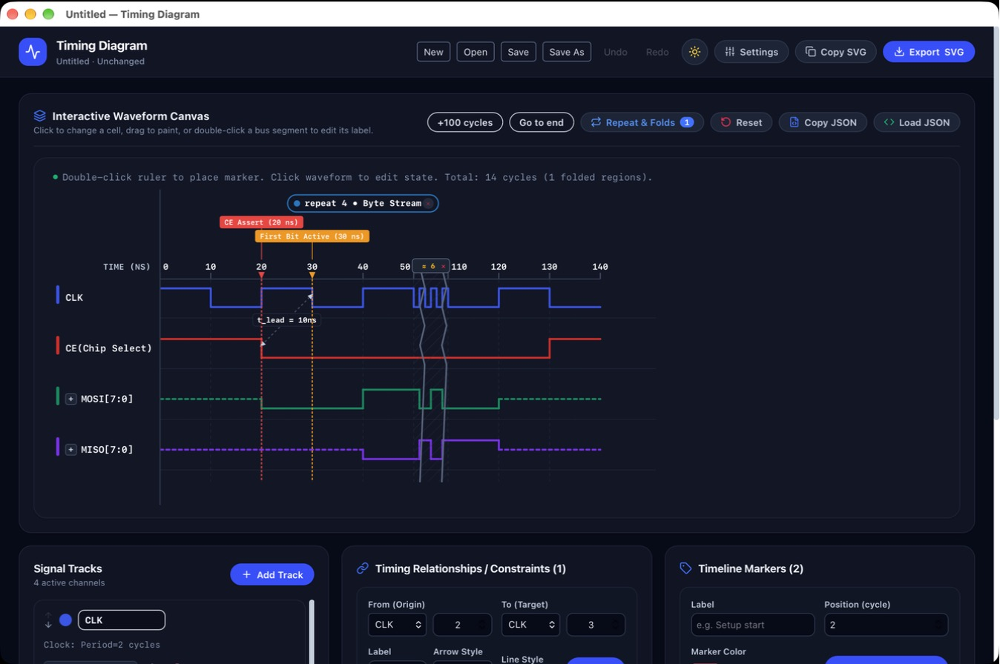
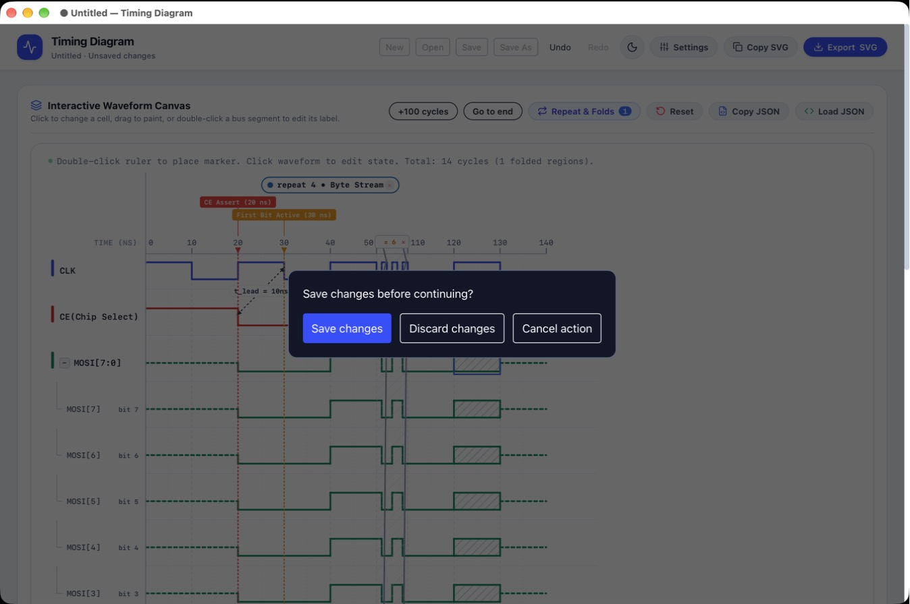

# Timing Diagram


[](https://buymeacoffee.com/oud0n)

タイミングチャートを SVG で作成・編集する React 19 + TypeScript + Vite アプリです。
ブラウザ版と Tauri 2 のデスクトップ版を提供します。旧 Electron 版はタグ `v3.0.1` で参照できます。

> **動作確認は macOS（27.0.1 / Apple Silicon）でのみ行っています。** Windows は GitHub Actions でのビルド成功のみを確認しており、Windows・Linux での実機動作は確認していません。

ブラウザ版は GitHub Pages で公開します: https://oud0n.github.io/timing_diagram/



| 展開バスの直接編集 | ダークテーマ | 未保存変更の確認 |
| --- | --- | --- |
|  |  |  |

画像は 2026-10-18 の実操作確認で、DMG からインストールした macOS 版を撮影したものです。

## 起動・検証

Node.js 24 以降と npm を使用します。

```sh
npm ci
npm run dev
```

表示されたローカル URL をブラウザで開いてください。

```sh
npm test          # JSON、履歴、反復検出、SVG、画面操作の回帰テスト
npm run lint     # TypeScript 型チェック
npm run build    # 型チェックと本番ビルド（dist/）
npm run preview  # ビルド済み Web アプリの確認
```

`main` へのプッシュで `.github/workflows/pages.yml` がテスト・ビルドし、`dist/` を GitHub Pages へデプロイします。ビルドは相対パス（Vite の `base: './'`）なので、リポジトリ名のサブパスでもデスクトップ版でも同じ成果物が動きます。リポジトリの Settings → Pages の Source は「GitHub Actions」に設定しています。ブラウザ版の保存はファイルのダウンロードで、読込はファイル選択です。Pages 版だけはアクセス数の計測に GoatCounter のスクリプトを読み込みます（ワークフローの `GOATCOUNTER_URL` を指定したビルドのみ）。デスクトップ版とローカルのビルドには含めません。

デスクトップ版は Rust / Cargo と各 OS のネイティブ開発環境も必要です。

```sh
npm run desktop:dev    # Tauri + Vite の開発起動
npm run desktop:build  # 配布パッケージ生成
cargo test --locked --manifest-path src-tauri/Cargo.toml
```

macOS の成果物は `src-tauri/target/release/bundle/macos/Timing Diagram.app` と `src-tauri/target/release/bundle/dmg/` に生成します。GitHub Actions は全ブランチへのプッシュで Web のテスト・ビルドを行い、手動実行またはバージョンタグで macOS / Windows パッケージを生成します（成果物は Actions の Artifacts）。Windows はこのビルド成功をもって確認済みとし、実機での確認は対象外です。Release 公開は自動化していません。

macOS のアプリはバンドル全体を ad-hoc 署名します。Developer ID 署名・公証はしていないため、他の Mac で開く場合は Gatekeeper の確認が必要です。

## macOS で「壊れているため開けません」と表示される場合

配布する macOS 版は Apple Silicon（arm64）専用です。Intel Mac では動作しません。

ブラウザ等でダウンロードした DMG からアプリを起動すると、「“Timing Diagram”は壊れているため開けません。ゴミ箱に入れる必要があります。」と表示される場合があります。

**原因:** 本アプリは個人開発のため、有償の Apple Developer Program による Developer ID 署名と公証（Notarization）を付けていません。macOS の Gatekeeper は、ダウンロードしたファイルに検疫属性（`com.apple.quarantine`）を付け、公証のないアプリの起動を止めます。ファイルが実際に壊れているわけではありません。

**解決方法:**

1. DMG 内の `Timing Diagram.app` を「アプリケーション（/Applications）」フォルダにコピーします。
2. ターミナルで次のコマンドを実行します。

```bash
xattr -cr "/Applications/Timing Diagram.app"
```

- `xattr`: macOS の拡張ファイル属性を表示・操作する標準コマンドです。
- `-c`: すべての拡張属性を消去します。ダウンロード時に付いた検疫属性（`com.apple.quarantine`）を外すことで、Gatekeeper による起動のブロックを解除します。
- `-r`: アプリバンドル（.app）内のすべてのファイルに再帰的に適用します。

**それでも開かない場合:** macOS のセキュリティポリシーによっては、署名の扱いが厳しく起動できないことがあります。その場合は、手元で ad-hoc 署名をやり直してください。

```bash
codesign --force --deep --sign - "/Applications/Timing Diagram.app"
```

- `--force`: 既存の署名を上書きします。
- `--deep`: バンドル内のすべてのコードに再帰的に署名します。
- `--sign -`: Developer ID の代わりに ad-hoc 署名（`-`）を使い、このMacでのローカル実行を許可する署名を作ります。

実行後、通常どおりダブルクリックするか、Control キーを押しながらクリックして「開く」を選んでください。

## 実装済みの操作

- 信号の追加・削除・並べ替え、波形文字列・色・線幅の設定
- Binary セルのクリック反転、バス等の `0 → 1 → = → z → x` 切替、ドラッグ塗り、選択セルの `0` / `1` キー編集
- Segment Painter で `0` / `1` / `z` / `x` / `=` を設定。継続記法を解決して編集し、後続セルの値を保持
- 周期・デューティ比・位相からのクロック生成。直接編集する場合は Convert clock to Binary で変換
- バスセルのダブルクリックでラベル編集、Enter で確定、Escape でキャンセル
- 波形文字列が終端を超えると時間軸を自動延長。`+100 cycles` で追加し、`Go to end` で末尾へ移動
- バスの値・表示形式・ビット幅の編集、ビット展開
- マーカー、信号間のタイミング制約、繰り返し検出・範囲指定、時間の折り畳み
- ダーク／ライトテーマ切替
- Undo / Redo ボタン、`Ctrl/Cmd+Z` / `Ctrl/Cmd+Shift+Z`
- JSON のクリップボードコピーと貼り付け読込
- New / Open / Save / Save As と未保存変更の保存・破棄・キャンセル確認
- デスクトップメニューと `Ctrl/Cmd+S`、`Ctrl/Cmd+Shift+S`、`Ctrl/Cmd+O`、`Ctrl/Cmd+E`
- 単体で表示できる SVG のコピー・ダウンロード

信号、設定、マーカー、制約、繰り返し、折り畳みの変更は共通の履歴に入ります。入力欄の編集はフォーカスを離れた時に1件にまとめます。入力欄内のショートカットは通常の文字編集を優先します。テーマと選択セルは図の履歴に含めません。

信号を削除すると、その信号を参照する制約も削除します。サイクル数を減らすと波形とバス値を切り詰め、マーカー・制約・範囲を新しい時間軸に収めます。これらも Undo で復元できます。

初期の終端140nsは14サイクル × 10nsの設定値です。Settings の Total Cycles でも延長できます。現在は最大100,000サイクル（10ns刻みで1ms）に対応します。SVGの横幅とメモリ使用量を考慮した上限があり、完全な無制限ではありません。長い図では目盛りを間引き、補助目盛りを省略します。SVG出力は表示中の範囲だけでなく全時間軸を含みます。

## JSON 形式と未保存状態

書き出しは現行 SVG エディタ形式に `formatVersion: 1` を付けます。必須の `config`、`signals`、`markers`、`constraints` と、任意の `repeatRanges`、`folds` を持ちます。省略した任意リストは空配列に正規化します。

現行形式のバージョンなし JSON も読込可能です。旧 Electron 形式は対応しません。未知のバージョン、不正な値、重複 ID、存在しない信号への参照は拒否し、現在の図を保持します。カラーは `#RGB` または `#RRGGBB`、波形記法は `0 1 z x = . ~ - h l`（大文字も可）です。

未保存表示は起動時、読込時、またはデスクトップ版の保存成功時の図との比較です。Undo で同じ図に戻ると表示が解除されます。Copy JSON や SVG 出力は保存済み状態を変更しません。デスクトップ版は同じディレクトリの一時ファイルから置換して保存します。JSON の読込上限は16 MiBです。ブラウザ版の Save はダウンロードとなり、保存済み扱いにはしません。自動保存はありません。

## 開発者を支援（Buy Me a Coffee）

**Timing Diagram** は個人が空き時間に開発しているプロジェクトです（無料・ソースコード公開）。編集機能の追加や不具合修正、macOS 版のビルドと GitHub Pages 版の維持を続けるため、コーヒー1杯（$3〜）からのご支援をいただけると大変励みになります ☕

👉 **[Buy Me a Coffee で oud0n を支援する](https://buymeacoffee.com/oud0n)**

アプリ内では、ヘッダーの「Support」ボタン、またはデスクトップ版のメニュー「Help → Support the Developer (Buy Me a Coffee)…」から、QR コード付きの支援画面を開けます。デスクトップ版のリンクは既定のブラウザで開きます（開ける URL は支援ページと GitHub リポジトリだけに制限しています）。

## 構成

- `src/App.tsx`: 画面と操作の接続
- `src/components/WaveformCanvas.tsx`: SVG 波形描画
- `src/components/`: 信号・マーカー・制約・繰り返しの編集 UI
- `src/document.ts`: JSON の検証・正規化・書き出し
- `src/history.ts` / `src/hooks/useDiagramHistory.ts`: 編集履歴と保存済み状態
- `src/svgExport.ts`: SVG のスタイル埋め込み・書き出し
- `src/waveformEditing.ts`: 継続記法を保持したセル編集・クロック変換
- `src/fileGateway.ts` / `src/hooks/useDocumentFiles.ts`: Web / ネイティブのファイル操作と未保存確認
- `src-tauri/`: ネイティブメニュー、ファイルダイアログ、保存処理、配布設定
- `src/utils.ts`: 波形解析・折り畳み座標・繰り返し検証
- `tests/`: 回帰テスト

## 動作確認

動作確認は macOS でのみ行っています（macOS 27.0.1 / arm64）。2026-10-18 に DMG から `/Applications` へインストールした配布版で、次の操作を確認しました。

- 起動・編集・保存・再起動後の読込・SVG 出力
- 展開バスと折り畳みを含む編集、横スクロール中のドラッグ塗りと図外でのポインタ解除、表示倍率変更後の編集
- 入力欄の Cmd+Z、最小ウィンドウ（640×480）での配置、テーマの再起動後の保持
- 不正 JSON・読取権限なし・書込不可フォルダでのエラー表示と図の保持、未保存終了時の保存・破棄

アプリは約10.39 MiB、DMG は約2.87 MiB です。起動からフロントエンドの準備完了まで約0.4秒です（5回測定、初回は約0.5秒）。ウィンドウは描画完了後に表示するため、起動時に白い画面は出ません。Windows はビルド成功のみの確認で、Windows・Linux の実機確認は対象外です。検証方法と結果は [TODO.md](./TODO.md) に記録しています。

## ライセンス

[PolyForm Noncommercial License 1.0.0](LICENSE)（Copyright 2025-2026 oud0n）

- **非商用であれば自由に使えます**: 個人的な目的（趣味・学習・研究など、商用につながらないもの）での利用と、非営利団体・教育機関・公的な研究機関・政府機関での利用は、改変・再配布を含めて自由です。再配布するときは、`LICENSE`（またはライセンスの URL）と `Required Notice:` の行を一緒に渡してください。
- **商用利用には事前の許諾が必要です**: 業務での利用、有償の製品・サービスへの組み込み、販売などを考えている方は、[caliber.trivia66@icloud.com](mailto:caliber.trivia66@icloud.com) までご連絡ください。
- **改変版を公開・配布するときのお願い**: 出どころが分かるよう、次を守ってください。
  - 本ソフトウェア（[oud0n/timing_diagram](https://github.com/oud0n/timing_diagram)）をもとにしていることと、改変したことを、README など利用者の目に入る場所に書く
  - 改変版には別の名前を付け、本家の公式版・公認版と誤解されるような名前や表示を使わない
